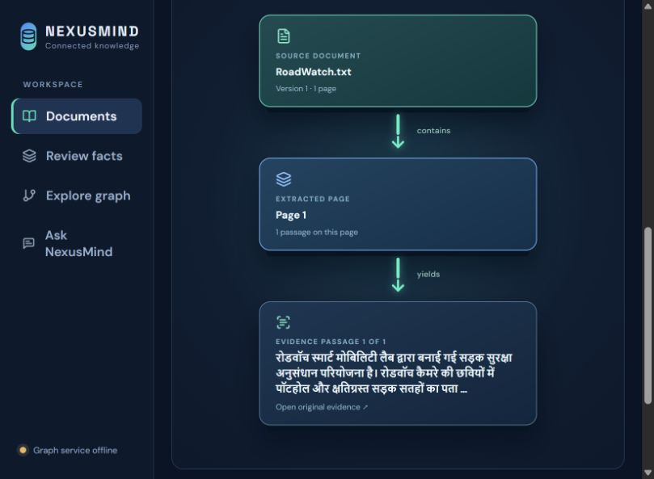

# NexusMind — AI-03 Interactive Knowledge Base

NexusMind ingests PDF and TXT documents, searches English source passages with a multilingual embedding model, and builds a reviewed graph of entities, facts, and topics. The graph uses Neo4j in Docker Compose or a SQLite-derived backend for local development. Every answer links to its source page. The document view offers a clean pictorial **document → page → passage** flowchart, while the graph view shows reviewed entity relationships. English passages and answers can be read in Hindi through local machine translation.



## Start the complete stack

Requirements: Docker Desktop with Compose, and internet access on first start to download images and the embedding model. The example configuration connects to a host Ollama installation with `qwen3.5:4b` downloaded.

```powershell
Copy-Item .env.example .env
# Set a private NEO4J_PASSWORD in .env. The Qwen connection is already shown in the example.
docker compose up --build
```

Open [NexusMind](http://localhost:5173), [API documentation](http://localhost:8000/docs), and [Neo4j Browser](http://localhost:7474). The API, worker, SQLite, Chroma, Neo4j, and frontend are defined in `compose.yaml`. Only localhost ports are exposed. Data and downloaded models live in Docker volumes. Do not commit `.env`.

On first launch, allow the embedding model to download before expecting the first document to become ready. The first English→Hindi translation downloads the Argos language package into the app's persistent data volume; later translations use the local model. Uploaded text is not sent to a translation service. `/health` reports SQLite, Chroma, Neo4j, and LLM configuration independently.

### Use the downloaded Qwen model

For local Windows development, run Ollama and verify that `ollama list` includes `qwen3.5:4b`. Copy `.env.local.example` to `.env.local`. The backend loads this file when started from the local checkout. It points to `http://127.0.0.1:11434/v1` and sets `LLM_API_KEY=ollama`, which is a placeholder ignored by the local Ollama server. Set `LLM_REASONING_EFFORT=none` to keep answer and fact extraction latency practical. `GRAPH_BACKEND=sqlite` derives the graph from current approved facts in SQLite, so local graph exploration does not depend on Neo4j. The UI shows the configured model and active graph backend.

For Docker Compose, `.env.example` uses `http://host.docker.internal:11434/v1` so containers can reach Ollama running on the Windows host. The Qwen model writes cited answer prose and proposes facts for human review; multilingual MiniLM still retrieves passages, and Argos handles English→Hindi document reading. If the model is stopped, passage retrieval remains available.

## Workflow

1. Upload one or more PDF or TXT documents. The worker extracts text, tries OCR on sparse PDF pages, splits passages, and indexes them in Chroma. Duplicate bytes resolve to the existing document.
2. Select a document to inspect its version, source flowchart, extracted text, and original file. Use the **English / हिंदी** switch to read a page or its flowchart in Hindi. Move through a page's passages with the flowchart arrows. Open a passage to compare its Hindi translation with the unchanged English source. Replace, retry, or delete a document under **Manage file**. Document metadata is versioned; current passage IDs include the version.
3. Add or edit facts in **Review facts**. Each fact needs an exact source quote and explicit support or denial. Approve facts before they enter the graph. An optional OpenAI-compatible LLM can suggest facts, but cannot approve them. Reviewers can reuse a project entity ID across documents when the evidence establishes the same identity; ambiguous names such as Atlas need separate IDs.
4. Open **Explore graph** to see up to 24 current approved relationships grouped by project. Click a relationship to open its exact source passage, or click a project to inspect its interactive graph. **Overview** returns to that map; entity search reaches connections beyond the overview. Create and review topic groups there; discovery combines semantic similarity with repeated filename collection hints, keeping different named collections separate.
5. Ask in English or Hindi. Graph questions return a path with source pages when reviewed facts exist; passage questions use multilingual retrieval. The answer panel can translate English output to Hindi. Explicitly contradictory approved claims are shown side by side with both sources.

Source text is untrusted data. The answer service filters common instruction-injection patterns, keeps graph evidence and citations under backend control, and abstains when evidence is insufficient. This is a defense in depth measure, not a guarantee against every possible injection. The included test corpus exercises 22 planted instructions. For high-stakes use, review the original source as well as the answer.

### Updates and consistency

Uploading or replacing a document immediately queues one document job; the collection is not rebuilt. Retrieval and citation queries expose only the current **ready** version. Old graph relationships and vector entries are removed during the worker job. Deletion removes the document, its indexed passages, and its graph projections. Newly extracted facts still require human approval before they appear in the graph, so the 60-second update target applies to indexing and retiring stale evidence, not to human review or a failed external service.

## Measured scale

`evaluation/benchmark.py` ingested **500 synthetic, one-passage TXT documents** on Windows 11 with the multilingual MiniLM model and a local Chroma service. It measured **73.649 seconds** total ingestion (**407.34 documents/minute**), including **11.149 seconds** to queue uploads. SQLite and Chroma each held **500 passages**. A single replacement completed in **0.307 seconds** and deletion in **0.048 seconds**; the old chunk was removed. See [the machine-readable report](evaluation/benchmark_results.json) and rerun it on your own hardware. This is a small-document throughput measurement; long PDFs, OCR, LLM extraction, and service contention will change results.

Neo4j was unavailable in the local test environment, so its graph size and end-to-end graph latency were **not measured**. The benchmark had no approved facts, so a graph with the project’s review policy would contain no fact edges at that stage. Once Neo4j is running, `/graph/stats` reports its current node and edge counts. No graph result has been fabricated for the benchmark.

## Local development

Start Chroma on port 8001 (and Neo4j if using `GRAPH_BACKEND=neo4j`), then in PowerShell from this folder:

```powershell
py -3.13 -m venv .venv
.\.venv\Scripts\python.exe -m pip install -r backend\requirements-dev.txt
$env:DATABASE_PATH = (Join-Path (Get-Location) 'data\ai03.db')
$env:UPLOAD_DIR = (Join-Path (Get-Location) 'data\uploads')
$env:NEO4J_URI = 'bolt://localhost:7687'
$env:NEO4J_USER = 'neo4j'
$env:NEO4J_PASSWORD = 'your-password-from-env'
$env:CHROMA_HOST = 'localhost'
$env:CHROMA_PORT = '8001'
$env:PYTHONPATH = (Join-Path (Get-Location) 'backend')
.\.venv\Scripts\python.exe -m uvicorn app.main:app --reload
```

In a second PowerShell window, set the same environment variables and run `.\.venv\Scripts\python.exe -m app.worker`. In a third window, run `npm ci` and `npm run dev` from `frontend`. If you change `EMBEDDING_MODEL`, run `.\.venv\Scripts\python.exe -m app.reindex` with the same database and Chroma settings to index existing current passages into the new model-specific collection.

Run the checks with:

```powershell
$env:PYTHONPATH = (Join-Path (Get-Location) 'backend')
.\.venv\Scripts\python.exe -m pytest backend\tests -q
Set-Location frontend
npm run build
```

The benchmark requires a running Chroma service and a clean `work/ai03-benchmark` directory. From the project root: `.\.venv\Scripts\python.exe evaluation\benchmark.py`. It writes `evaluation/benchmark_results.json` and uses a separate SQLite file and Chroma collection from the app.

## Storage and limits

- SQLite stores document versions, processing jobs, pages, passages, review status, and topic membership.
- Chroma stores multilingual passage embeddings and source metadata. The collection name is tied to the embedding model unless `CHROMA_COLLECTION` is explicitly set.
- SQLite caches Hindi translations by versioned passage ID; replacing or deleting a document retires those translations with its passages. [Argos Translate](https://www.argosopentech.com/) runs locally and downloads only the English→Hindi model package. Machine translation is a reading aid; the English original remains the evidence of record.
- Neo4j stores **approved** entity relationships and topics in Docker mode. `GRAPH_BACKEND=sqlite` builds the same reviewed entity graph from approved, current SQLite facts and topic memberships. Graph paths use only current, reviewed evidence.
- If Neo4j mode is selected and Neo4j is offline, graph questions visibly fall back to cited passage retrieval without claiming a graph path. The SQLite mode keeps graph exploration available locally.
- Without a configured LLM, fact suggestions and generated prose are unavailable; manual review and extractive passage answers still work.
- No user accounts or access control are included. Use a trusted local machine or add authentication before exposing this service beyond localhost.
- The document diagram is a pictorial flowchart; it is not a 3D physics visualization. This keeps long reports easier to read and use with keyboard controls.
