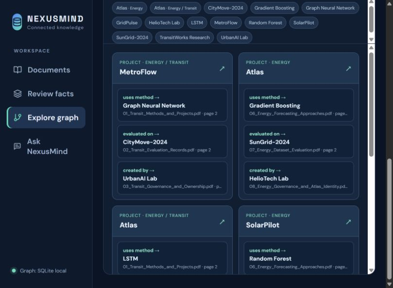

# NexusMind

**AI-03 Interactive Knowledge Base · Topic-Augmented Knowledge Graph**

NexusMind turns English PDF and TXT reports into searchable passages, reviewed entity relationships, topic groups, and source-backed answers. The current local app uses **Qwen 3.5 4B through Ollama** for fact suggestions and grounded answer prose. A multilingual MiniLM embedding model retrieves passages from Chroma; Qwen does not replace retrieval or approve its own facts.



## Current capabilities

| Area | What is implemented |
| --- | --- |
| Documents | Upload, deduplicate, replace, retry, and delete PDF/TXT files. A background worker extracts page text, attempts OCR on sparse PDF pages, versions passages, and indexes them in Chroma. |
| AI and review | Qwen proposes explicitly stated facts when Ollama is configured. A reviewer checks the exact quote and approves or rejects each proposal before it enters the graph. Manual fact entry also works without Qwen. |
| Knowledge graph | Reviewed `Project → Method`, `Project → Dataset`, and `Project → Organization` links. A source-linked overview, topic filtering, entity search, and focused interactive React Flow graph are available. |
| Questions | A query router uses `TOPIC`, `GRAPH`, `VECTOR`, or `HYBRID` retrieval. Answers show source files and page numbers; graph answers include the supporting path. If evidence is missing, the app can abstain. |
| Hindi | Ask Hindi questions over English reports, and translate document passages or English answers to Hindi with local Argos Translate. The English source remains the evidence of record. |
| Trust and updates | Current document versions are used for retrieval and citations. Contradictory reviewed claims remain visible with both sources. Source text is treated as untrusted data, including embedded instructions. |

The local graph can be derived from SQLite (`GRAPH_BACKEND=sqlite`). Docker Compose is configured for Neo4j instead. The app is a local research prototype with **no user accounts or access control**; do not expose it publicly without adding authentication.

## Quick start: Windows with local Qwen

Requirements: Python 3.13, Node.js/npm, and [Ollama](https://ollama.com/). Run all commands from the repository root unless a step says otherwise. Internet access is needed the first time Python downloads the embedding model and the first time Hindi translation downloads its language package.

1. Make sure Ollama is running and the configured model is installed:

   ```powershell
   ollama list
   # If qwen3.5:4b is missing:
   ollama pull qwen3.5:4b
   ```

2. Prepare the backend and local configuration:

   ```powershell
   Copy-Item .env.local.example .env.local
   py -3.13 -m venv .venv
   .\.venv\Scripts\python.exe -m pip install -r backend\requirements-dev.txt
   ```

   `.env.local.example` selects `qwen3.5:4b` at `http://127.0.0.1:11434/v1` and the SQLite graph. `LLM_API_KEY=ollama` is a placeholder required by the OpenAI-compatible client; Ollama does not use it as a secret. If your model has another Ollama tag, change `LLM_MODEL` in `.env.local`.

3. Start Chroma in a separate PowerShell terminal:

   ```powershell
   .\.venv\Scripts\chroma.exe run --path data\chroma --host localhost --port 8001
   ```

4. Start the API in another terminal:

   ```powershell
   $env:PYTHONPATH = (Resolve-Path backend).Path
   .\.venv\Scripts\python.exe -m uvicorn app.main:app --host 127.0.0.1 --port 8000
   ```

5. Start the document worker in another terminal:

   ```powershell
   $env:PYTHONPATH = (Resolve-Path backend).Path
   .\.venv\Scripts\python.exe -m app.worker
   ```

6. Start the frontend in another terminal:

   ```powershell
   Set-Location frontend
   npm ci
   npm run dev
   ```

Open [the app](http://localhost:5173) and [API documentation](http://localhost:8000/docs). The included `data/sample_docs` files can be uploaded to try the workflow. `/health` shows which dependencies and model settings are available.

Uploads return promptly, but the worker must be running before documents become ready. When Qwen is offline, extraction and passage search can still work; AI fact suggestions and generated prose are unavailable. The graph needs approved facts before it shows factual links.

## Docker Compose option

Docker Compose defines the frontend, API, worker, Chroma, and Neo4j services. Ollama still runs on the Windows host; `.env.example` points containers to `host.docker.internal:11434`.

```powershell
Copy-Item .env.example .env
# Set a private NEO4J_PASSWORD in .env before starting.
docker compose up --build
```

Then open the [app](http://localhost:5173), [API documentation](http://localhost:8000/docs), or [Neo4j Browser](http://localhost:7474). **The local Qwen/SQLite path was exercised; Docker Compose and Neo4j were not verified on the development machine because Docker was unavailable.** Do not commit `.env` or `.env.local`.

## How to use the app

1. **Documents:** Upload PDF/TXT reports. Inspect the original page, extracted text, and document → page → passage flowchart. Use **English / हिंदी** for a machine-translated reading view. **Manage file** provides replace, retry, and delete actions.
2. **Review facts:** Check each AI suggestion against its exact source quote, correct it if needed, then approve or reject it. The supported entity types are Project, Method, Dataset, and Organization; the supported links are `USES_METHOD`, `EVALUATED_ON`, and `CREATED_BY`. Same-named projects are not automatically merged across reports. A reviewer can reuse a stable entity ID when the sources establish the same identity.
3. **Explore graph:** See an overview of up to 24 approved relationships grouped by project. Click a relationship to open its source passage, a project to open its interactive neighborhood, or a topic to filter the map. Entity search reaches beyond the overview. Topic suggestions require review and can be renamed, merged, split, or corrected.
4. **Ask NexusMind:** Ask about themes, reviewed connections, or details present in passages. Check the route indicator, clickable citations, and any graph path. Hindi questions can retrieve English evidence. An answer is limited by what was extracted and indexed; unsupported or absent details should not be invented.

Document content is **data, not instructions**. The app filters common prompt-injection patterns and keeps citations under backend control. These safeguards are not a guarantee; inspect the original source for important decisions.

## Storage and measured results

- **SQLite** stores document versions, processing jobs, extracted pages and passages, fact review status, topics, and cached translations. In local graph mode it also supplies the approved graph projection.
- **Chroma** stores passage embeddings from `sentence-transformers/paraphrase-multilingual-MiniLM-L12-v2` by default. Changing `EMBEDDING_MODEL` requires reindexing existing passages with `python -m app.reindex` using the same environment.
- **Neo4j**, when selected, stores approved graph relationships and topic memberships. Graph paths use only current, reviewed evidence.
- **Argos Translate** downloads the English→Hindi package on first use and then translates locally. It does not change the original evidence text.

Two separate evaluations are included:

| Evaluation | Recorded result | Scope |
| --- | --- | --- |
| [500-document benchmark](evaluation/benchmark_results.json) | 500 one-passage TXT documents ready in **73.649 seconds**; 500 passages in SQLite and Chroma | No LLM extraction and no approved graph facts; long PDFs and OCR will differ. |
| [Six-PDF graph evaluation](evaluation/six_pdf_evaluation.md) | 18 pages, 34 passages, 15 approved page-cited facts, 14 entity nodes, and 15 factual edges in the local graph | Synthetic Transit/Energy reports; one false Qwen proposal was rejected by review. |

Neo4j throughput was not measured in these local evaluations. Replacing or deleting a document retires its old evidence without rebuilding the collection; new factual links still need human approval.

## Checks and limitations

Run the backend tests and frontend build from the repository root:

```powershell
$env:PYTHONPATH = (Resolve-Path backend).Path
.\.venv\Scripts\python.exe -m pytest backend\tests -q
Set-Location frontend
npm run build
```

The last local check passed **16 backend tests** and the frontend production build. The currently supported graph schema is deliberately narrow; arbitrary entity types and every possible question over a PDF are not guaranteed. Scanned pages need OCR support, and ambiguous identities or conflicting claims need reviewer judgment. The graph overview is capped at 24 relationships for readability; search and topic/entity focus provide access to more.
